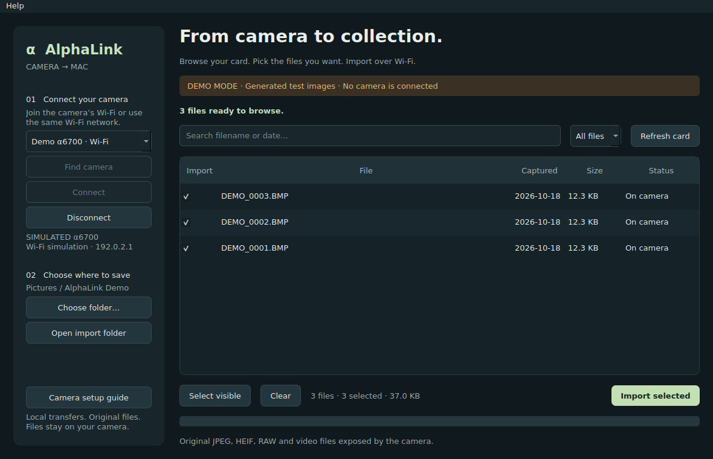

# AlphaLink for Mac

Import original photos and videos from a Sony α6700 over Wi-Fi. Browse the camera's card, select files, and save them into date folders on your Mac. Double-click imported files for Quick Look; use Finder's Share menu to send them onward.

**Delivery status:** implemented source project, with automated software and simulated-SDK tests. This package is not a precompiled, notarized installer. A physical α6700 connection, the macOS build, and real-camera transfer performance still need validation on a Mac.



## Start on your Mac

1. Use **macOS 14.1 or newer**, Python **3.11–3.13**, and Apple's Command Line Tools (`xcode-select --install`). Both Apple Silicon and Intel are intended targets; build on the Mac that will run the app.
2. Download the **Mac Camera Remote SDK 2.02.00** from [Sony](https://support.d-imaging.sony.co.jp/app/sdk/licenseagreement_d/en-US.html), reviewing its terms yourself. Keep the ZIP. Sony's SDK binaries and headers are not included here.
3. Unzip this project and double-click **Setup.command**. It installs the Python dependencies, runs the standard tests, asks you to choose Sony's ZIP, and builds **dist/AlphaLink.app**. First setup needs internet; normal imports are local.
4. Open **dist/AlphaLink.app**. You can copy the completed app into Applications. Allow local network access if macOS requests it.
5. On the camera, enable PC Remote. Open **Wi-Fi Direct Info**, then join that camera network from the Mac's Wi-Fi menu. Alternatively connect both devices to the same access point.
6. Click **Find camera → Connect**, confirm any camera pairing prompt, select files, and **Import selected**.

For an exact camera walkthrough, build troubleshooting, or terminal setup, read [docs/SETUP.md](docs/SETUP.md).

## Included

- Desktop interface with wireless camera discovery, search and Photo/RAW/Video filters.
- Sony SDK **Contents Transfer** connection, card listing, original-size downloads and asynchronous completion callbacks.
- Session-only camera credentials and explicit camera fingerprint comparison when SSH authentication is supported.
- Sequential imports, byte progress, and **Stop after current file**.
- Date folders, local SQLite import receipts, local SHA-256 validation before skipping a repeat import.
- Staging files; incomplete transfers remain clearly marked and never appear as completed imports.
- Atomic file publication without overwriting an existing file. Select a local APFS/HFS+ destination.
- Quick Look for completed imports and a button to open the import folder.
- Explicit `--demo` mode, tests, macOS build script and setup guide.

## Scope of this version

This transfers camera → Mac; it does not write to or delete from the camera. It does not implement Bluetooth wake-up, automatic Wi-Fi joining, remote shooting, camera thumbnail browsing, cloud upload, transcoding, or byte-range transfer resume. After an interruption, reconnect and retry the selected files; verified completed files are skipped. The app does not promise a transfer speed or support for every recorded codec/file variant. Files available to this app are the ones the camera exposes through Sony's Contents Transfer API.

## Creators’ App reference

I checked Sony's public Creators’ App information and looked for an official public iOS/Android source repository. I did **not** locate its full source and have not reviewed or copied its proprietary implementation. AlphaLink is original code using Sony's documented Camera Remote SDK, not the older PlayMemories JSON API. [docs/RESEARCH.md](docs/RESEARCH.md) records the sources and exact SDK support checked.

## Developer commands

```bash
python3 -m venv .venv
source .venv/bin/activate
python -m pip install -e '.[build,test]'
python -m pytest -q
python -m alphalink --demo
# On macOS, build the engine and app using Sony's downloaded ZIP:
python scripts/build_mac.py --sdk /path/to/CrSDK_v2.02.00_20260610a_Mac.zip
```

Optional native callback tests compile the real adapter against a test-only SDK simulator using the headers you separately downloaded:

```bash
SONY_SDK_HEADERS=/path/to/RemoteCli/app/CRSDK python -m pytest -q
```

See [docs/ARCHITECTURE.md](docs/ARCHITECTURE.md) for component behavior and [docs/VALIDATION.md](docs/VALIDATION.md) for what has and has not been checked.

AlphaLink is independent software, not a Sony product. Original project code is MIT licensed. Sony SDK and third-party dependency licenses are separate; see [THIRD_PARTY_NOTICES.md](THIRD_PARTY_NOTICES.md).
